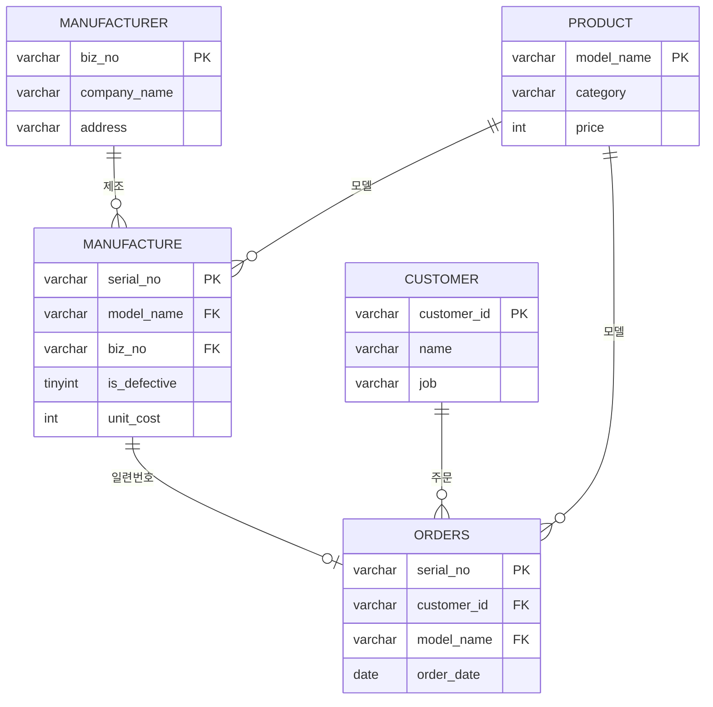

# LG전자 제품 판매 DB — MySQL 구현 및 분석

데이터베이스관리 수업 팀프로젝트에서 직접 설계했던 **ERD와 SQL 쿼리 15개를 바탕으로, MySQL에서 판매 DB를 구현**했습니다.
쿼리를 실행하는 데서 끝내지 않고 **데이터가 제대로 들어갔는지 검증**하고, 기존 쿼리의 **오류를 찾아 수정**하고, **CTE·윈도우 함수**로 분석을 확장했습니다.

| 구분 | 내용 |
|---|---|
| 배경 | 데이터베이스관리 수업 팀프로젝트 (2024.04 ~ 2024.06) · 본인 역할: ERD 설계, 요구조건별 SQL 설계 |
| 환경 | MySQL 8.4, MySQL Workbench |
| 데이터 | 제조사 32 · 상품 30 · 고객 50 · 제조 154 · 주문 36건 (수업용 가상 데이터) |

## 파일 구성

```
├─ lg_sales_mysql.sql     실행 스크립트 (스키마 → 적재 → 검증 → 품질 점검 → 쿼리 15개 → 확장 분석)
├─ lg_sales_result.txt    전체 실행 결과 (쿼리와 결과가 순서대로 기록됨)
└─ data/                  테이블별 원본 데이터 5개
```

`lg_sales_mysql.sql`을 Workbench에서 열고 전체 실행하면 DB 생성부터 분석까지 한 번에 재현됩니다.

## 시나리오

LG전자 제품 판매 마케팅 부서가 3개월간 판매한 제품과 협력 제조사 32곳의 정보를 DB로 관리하는 상황입니다.
제조(유통·상품 관리)와 판매(주문·회원 관리) 업무에서 8개 요구조건을 도출하고, 이를 15개 쿼리로 구현했습니다.

| 업무 | 요구조건 |
|---|---|
| 제조 | 제품 수요 확인과 주문량 결정 · 제조사별 담당 모델 확인 · 상품별 제조량 · 불량품 관리 |
| 판매 | 주문내역 조회 · 판매량·매출액 통계 · 회원 유형별 추천상품 · 배송지(송장) 관리 |

## 데이터 모델



제품 1대 = 1행입니다. 주문은 **일련번호**로 제조 이력과 연결되어, 판매된 제품이 어느 제조사에서 언제 만들어졌고 불량 판정을 받았는지까지 추적할 수 있습니다.

## 1. 데이터 적재 검증

데이터를 넣은 뒤 바로 분석하지 않고, 원본과 같은지부터 확인했습니다.

| 점검 | 방법 | 결과 |
|---|---|---|
| 건수 | 테이블별 `COUNT(*)`를 원본 행 수와 비교 | 5개 테이블 모두 일치 |
| 날짜 | 날짜 컬럼의 최솟값·최댓값 확인 | 주문 2024-01-09 ~ 2024-05-03, 이상 없음 |
| 값 범위 | 불량여부가 0/1만 있는지 | 정상 134 · 불량 20 |
| 참조 무결성 | 주문 모델명과 제조 이력 모델명 일치 여부 | 불일치 0건 |

## 2. 기존 쿼리 오류 발견과 수정

수업 때 작성한 쿼리 15개를 MySQL에서 다시 실행하며 결과를 하나씩 검증했습니다.
**12번 "제조사별 생산건수 / 예상 매출액"** 에서 결과가 부풀려지는 오류를 발견했습니다.

**원인.** 제조와 주문을 `모델명`으로 조인해, 같은 모델의 제조 N대 × 주문 M건이 모두 짝지어졌습니다.

| 기존 쿼리 조인 결과 | 실제 제조 대수 | 실제 주문 건수 |
|---:|---:|---:|
| **191행** | 154대 | 36건 |

| 제조사 예시 (라온기술) | 생산건수 | 매출액 |
|---|---:|---:|
| 기존 쿼리 | 40 | 61,362,500 |
| 수정 쿼리 | 10 (판매 7) | 11,346,290 |

**수정.** 주문과 제조를 `일련번호`로 연결해 제품 1대가 1행으로 유지되도록 바꿨습니다. 실제 판매 매출과, 정상품이 모두 팔렸을 때의 잠재 매출을 따로 계산했습니다. 주문이 없는 제조사가 결과에서 빠지던 문제도 `LEFT JOIN`으로 해결했습니다.

## 3. 데이터 품질 점검 (예외 케이스)

| 점검 규칙 | 결과 |
|---|---|
| 불량 판정 제품이 판매된 건 | **4건** |
| 제조단가 ≥ 판매가 (역마진) | **6건** (FS064PSJA 4대: 단가 1,900,000 > 판매가 1,487,000) |
| 같은 모델에 제조단가가 여러 개 | 4개 모델 (S3MFC는 3종) |
| 이메일 형식 오류 (`@` 없음) | 1건 |
| 전화번호 형식 불일치 | 8건 (해외 번호 표기 혼재) |
| 출시 전 주문 | 0건 |

## 4. 요구조건별 쿼리 15개

| # | 쿼리 | 주요 기법 |
|---|---|---|
| 1 | 고객번호로 배송지 검색 | 매개변수(`@변수`) |
| 2 | 모델별 불량 개수 | `JOIN`, `GROUP BY`, 조건 집계 |
| 3 | 불량만 보기 | 조건 필터 |
| 4 | 제조사 국가/지역 검색 | `LIKE CONCAT('%', @변수, '%')` |
| 5 | 제조사 연락처 검색 | 부분 일치 검색 |
| 6 | 날짜별 주문내역 / 송장 | 3개 테이블 `JOIN` |
| 7 | 특정 고객 주문내역 | 3개 테이블 `JOIN` |
| 8 | 상품별 제조량 | `COUNT`, `GROUP BY` |
| 9 | 상품별 주문량 | `COUNT`, `GROUP BY` |
| 10 | 상품별 판매량 / 매출액 | `COUNT`·`SUM` 동시 집계 |
| 11 | 제조사별 담당 모델 | 매개변수, `JOIN` |
| 12 | 제조사별 생산건수 / 매출액 | 기존 쿼리 + 부풀림 확인 + 수정본 (`LEFT JOIN`) |
| 13 | 주문된 모델 수량 | `GROUP BY` |
| 14 | 직업별 상품 추천 | 스칼라 서브쿼리, `CASE` |
| 15 | 카테고리별 판매 수요 | 13번 결과를 CTE로 재사용 |

매개변수 값은 스크립트 상단의 `SET @변수` 한 곳에서 바꾸면, 같은 요청에 같은 기준으로 결과를 다시 낼 수 있습니다.

## 5. CTE · 윈도우 함수 확장 분석

| 분석 | 사용 기법 | 개선점 |
|---|---|---|
| 직업별 추천 상품 | CTE (대상 고객 + 추천 규칙 표) | 같은 서브쿼리 6번 반복 → 규칙을 표로 분리해 수정 지점을 한 곳으로 |
| 월별·누적 매출, 전월 대비 증감 | `SUM() OVER`, `LAG()` | |
| 카테고리 내 모델 매출 순위·점유율 | `RANK() OVER (PARTITION BY)` | |
| 제조사별 불량률 순위 | `DENSE_RANK()` | 표본이 적은 제조사 별도 표시 |
| 모델별 판매 가능 재고·판매율 | `LEFT JOIN` + `RANK()` | |
| 직업군별 매출 비중·객단가 | `SUM() OVER ()` | |

## 배운 점

- 쿼리가 오류 없이 실행되는 것과 결과가 맞는 것은 다릅니다. **조인 키를 잘못 잡으면 행이 조용히 늘어납니다.** 그래서 조인 전후 건수를 비교하는 검증을 습관으로 삼게 됐습니다.
- 매개변수와 반복되던 서브쿼리를 변수와 CTE로 정리하니, 같은 요청이 다시 와도 **값만 바꿔 같은 결과**를 낼 수 있었습니다.
